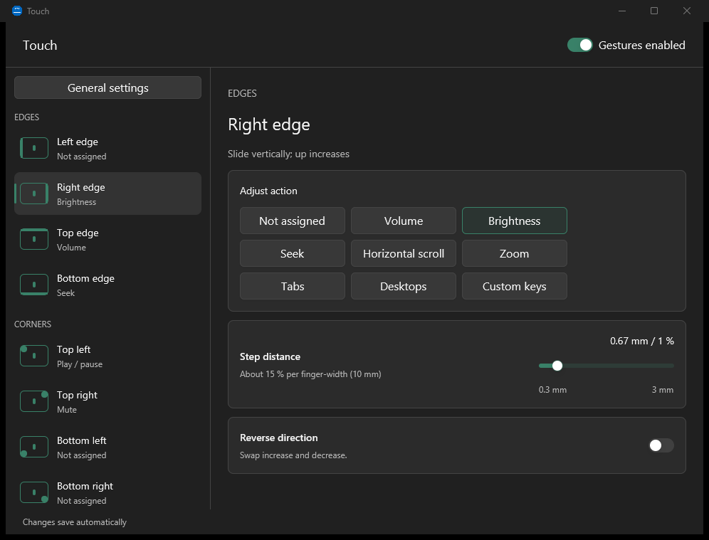
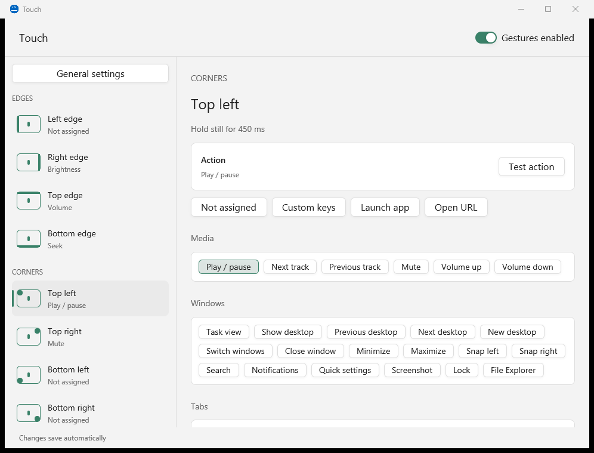
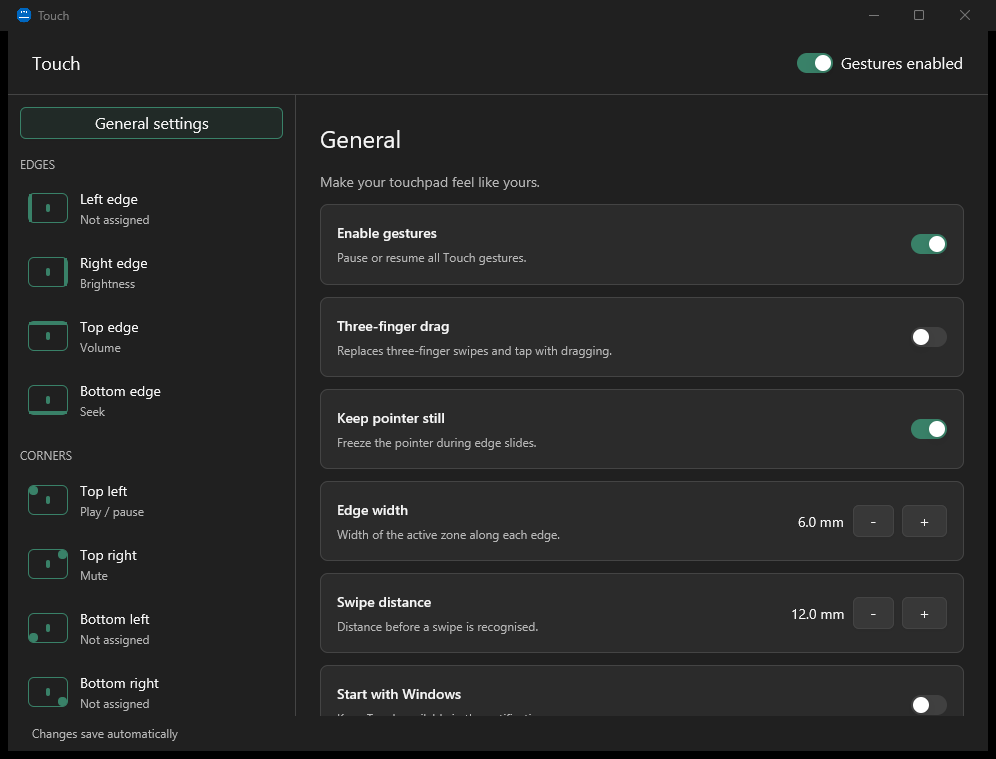

<div align="center">


# Touch

**Custom touchpad gestures for Windows.**
Slide along an edge to change the volume, hold a corner to pause music, swipe with three fingers to switch tabs,
and choose what every gesture does.

[](https://github.com/SumirSeth/touch/actions/workflows/ci.yml)
[](https://github.com/SumirSeth/touch/releases/latest)
[](https://github.com/SumirSeth/touch/releases)
[](LICENSE)


[**Download**](https://github.com/SumirSeth/touch/releases/latest) ·
[Features](#features) ·
[FAQ](#faq) ·
[Build from source](#build-from-source) ·
[Contributing](CONTRIBUTING.md)



</div>

## Why

Windows gives Precision Touchpads a handful of fixed 3- and 4-finger gestures. Touch adds the rest: edges, corners,
pinches and twists. Each one can do anything you like. It runs quietly in the tray, and pointer movement, scrolling
and clicks stay exactly as Windows does them.

## Features

**Gestures**

| Gesture | Out of the box |
|---|---|
| Slide one finger along the **right / top / bottom / left edge** | brightness / volume / seek video / — |
| **Hold** one finger still in a **corner** | top-left: play/pause, top-right: mute |
| **3- and 4-finger swipes** up, down, left, right | — |
| **3- and 4-finger taps** | — |
| **4-finger twist** like a knob | volume |
| **5-finger pinch** in / out | Task View |
| **5-finger twist** clockwise / anticlockwise | reopen tab / close tab |

**Actions**

- **Presets**: Task View, show desktop, switch or create virtual desktops, snap and minimise windows, Alt+Tab,
  close/reopen/next/previous tab, back/forward, copy/paste/undo/redo, search, notifications, quick settings,
  screenshot, lock, File Explorer, media keys.
- **Any keyboard shortcut**: record it by pressing the keys.
- **Launch an app or file**, or **open a URL**.
- **Continuous controls** for edges and the twist: volume, brightness, seek, horizontal scroll, zoom, tabs, virtual
  desktops, or your own pair of shortcuts. Sensitivity and direction are adjustable.

**Also**

- Native settings window rendered on the GPU with [GPUI](https://www.gpui.rs/). It follows your light/dark theme and
  accent colour.
- A **Test** button for every action. The gesture's row lights up when you perform it, which is handy for learning
  the gestures.
- Optional **3-finger drag**, pause from the tray, start with Windows.
- Small and local: one native Rust executable with no telemetry and no network access. Settings are stored in a
  readable JSON file.

<p align="center">
  
  
</p>

## Install

1. Download **`touch_<version>_x64-setup.exe`** from the [latest release](https://github.com/SumirSeth/touch/releases/latest)
   and run it. It installs for your user only, no administrator needed. An `.msi` is also available for managed
   installs.
2. Touch opens its settings and puts an icon in the tray. Click the icon any time to come back. Right-click it for
   **Pause gestures**, **Start with Windows** and **Quit**.

> [!NOTE]
> The installers aren't code-signed yet, so Microsoft Defender SmartScreen may show "Windows protected your PC".
> Choose **More info → Run anyway**. You can check the download against the release's build log on GitHub
> Actions, or [build it yourself](#build-from-source).

**Requirements:** Windows 10 1809 or later (developed on Windows 11) and a
Precision Touchpad, which
most laptops from the last several years have. Check under *Settings → Bluetooth & devices → Touchpad*. If you see
"Your PC has a precision touchpad", you're set.

### Using 3- and 4-finger gestures

Windows has its own 3- and 4-finger swipes and taps. **If you give one of those to Touch, set the matching Windows
gesture to "Nothing"** under *Settings → Bluetooth & devices → Touchpad → Three-finger / Four-finger gestures*.
Otherwise both will run. Touch shows a warning, with a button that opens that page, whenever this applies.

## FAQ

<details>
<summary><b>Does Touch replace Windows' touchpad driver or hook into Explorer?</b></summary>

No. Touch only *listens* to the touchpad through the standard Raw Input API, alongside Windows. It performs actions
by sending ordinary keystrokes (`SendInput`), opening things with `ShellExecute`, and setting brightness through
WMI. It installs no drivers, hooks or DLL injection, and needs no admin rights.
</details>

<details>
<summary><b>A gesture does two things at once.</b></summary>

Windows is also handling it. Set the Windows gesture for that finger count to "Nothing" (see above).
</details>

<details>
<summary><b>Edge slides don't trigger.</b></summary>

Start the slide with the finger *landing* inside the edge strip (6 mm by default, adjustable under General), then
move along the edge. Landing in the middle and moving to the edge is treated as normal pointer movement on purpose.
</details>

<details>
<summary><b>Brightness doesn't change.</b></summary>

Brightness control works on built-in laptop panels that support WMI brightness. External monitors usually don't.
</details>

<details>
<summary><b>Seek doesn't work in my video player.</b></summary>

Seek presses the Left/Right arrow keys, so the player window must have focus. YouTube, Netflix, VLC and most
players use them to skip back and forward. For a player with different keys, use **Custom keys** instead.
</details>

<details>
<summary><b>Where are my settings? How do I uninstall?</b></summary>

Settings live in `%APPDATA%\Touch\config.json`. Uninstall from *Settings → Apps → Installed apps*. Delete that
folder too if you want a clean slate.
</details>

## Build from source

You need Windows 10/11 x64, [Rust](https://rustup.rs) (stable, MSVC toolchain) and the
[Visual Studio Build Tools](https://visualstudio.microsoft.com/visual-cpp-build-tools/) with the *Desktop development
with C++* workload (including a Windows SDK).

```powershell
git clone https://github.com/SumirSeth/touch
cd touch
cargo run -p touch            # build and run (debug builds keep a console for logs)
cargo test --workspace        # gesture recognisers are tested on synthetic touch frames; no hardware needed
```

To build the installers (NSIS `.exe` and `.msi`, written to `target/installers/`):

```powershell
powershell -ExecutionPolicy Bypass -File app/scripts/package.ps1
```

### Project layout

```
crates/engine/   gestures_engine: reads the touchpad (Raw Input + HID), recognises gestures, runs actions, config
app/             the tray app and GPUI settings window
app/vendor/gpui/ GPUI 0.2.2 with two small Windows patches (see PATCH.md there)
docs/            design notes and screenshots
```

How it works: the engine registers for Precision Touchpad reports with `RIDEV_INPUTSINK` on its own thread. It
rebuilds each scan of the pad into a frame of contacts in millimetres and feeds it to pure recognisers. Those emit
events that an action worker carries out. See [`docs/app-spec.md`](docs/app-spec.md) for the full design.

## Roadmap

Ideas, not promises. Open an issue if you want one of them:

- Per-app gesture profiles
- Code-signed installers and a winget package
- More gestures (2-finger edge swipes, double-taps on corners)
- Lower idle memory when the settings window is closed

## Contributing

Bug reports, gesture ideas and pull requests are welcome. Please read [CONTRIBUTING.md](CONTRIBUTING.md) first. When
reporting a bug, include your Windows version and laptop/touchpad model, because touchpads differ.

## License

[MIT](LICENSE) © Sumir Seth. GPUI is used under the Apache-2.0 license (`app/vendor/gpui/LICENSE-APACHE`).
